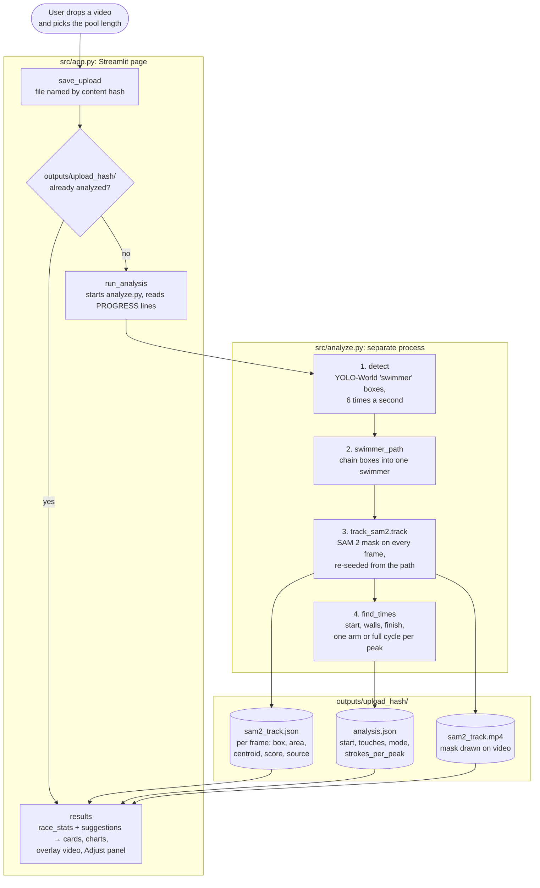
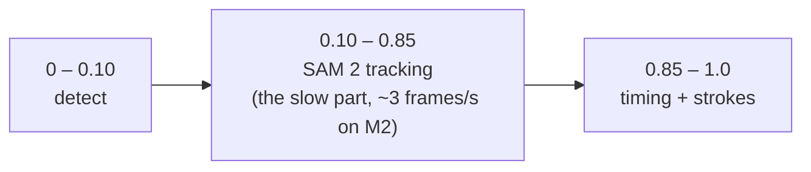

# 1. System overview

The page (`src/app.py`) never runs a model itself. It starts
`src/analyze.py` in its own process, reads its `PROGRESS` lines for the
progress bar, and when it ends reads the JSON files it wrote.

## Who does what

| file | job | uses a neural network? |
|---|---|---|
| `app.py` | page, upload, cache, results | no |
| `analyze.py` | runs the four steps | calls the two below |
| YOLO-World (in `analyze.detect`) | "where is a swimmer?" → boxes | yes |
| `track_sam2.py` | "which pixels are that swimmer?" → mask per frame | yes, SAM 2 |
| `timing.py` | start, walls, finish from motion | no: optical flow + signal rules |
| `start_beep.py` | start beep in the audio | no |
| `race_stats.py` | strokes, rate, DPS, splits from the mask shape | no: signal processing |
| `suggestions.py` | advice text from the stats | no |
| `web_video.py` | re-encode for the browser | no |

The two networks only answer *where* the swimmer is. Every race number is
computed afterwards from the mask's box, area and centroid, with plain
NumPy/OpenCV.

## Why the detector *and* the segmenter

- **YOLO-World alone** gives a box every few frames, often misses a swimmer
  under water or in splash, and sometimes boxes another lane. A box is too
  coarse to see an arm lift out of the water.
- **SAM 2 alone** gives a precise outline on every frame, but must be told
  once where the swimmer is, and drifts onto splash or a lane rope.

So YOLO-World finds and re-finds the swimmer (seeds), and SAM 2 does the
frame-by-frame outline. See [2](02-yolo-world.md) and [3](03-sam2-tracking.md).

## Progress bar split

