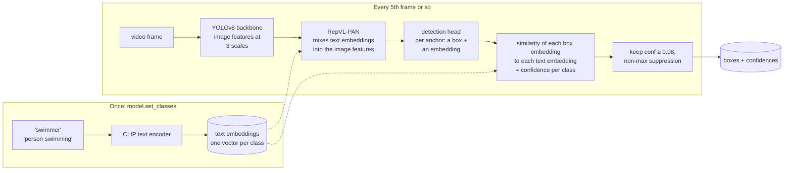
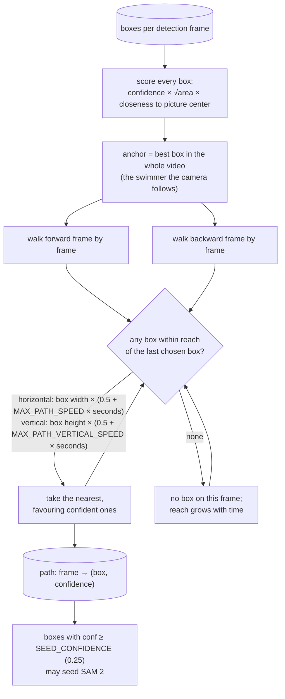

# 2. Finding the swimmer: YOLO-World

Code: `detect` and `swimmer_path` in `src/analyze.py`.
Weights: `models/yolov8s-worldv2.pt`.

## What YOLO-World is

A normal YOLO is trained on a fixed list of classes (COCO's 80: person,
car, ...). "Swimmer" is not one of them. YOLO-World is *open-vocabulary*:
you give it class names as text, and it finds boxes that match the text.

Key idea: the class is not a fixed output neuron; it is "how close is this
region's embedding to the embedding of the word". That is why text prompts
work without retraining, and also why confidences are low (0.1–0.4 is
normal here) and why "swimmer" sometimes fires on a person on the deck.

## From many boxes to one swimmer path

`detect` runs YOLO-World `DETECTIONS_PER_S` (6) times a second and drops
boxes taller than `MAX_TALL` × their width: a swimmer lies flat.
`swimmer_path` then picks *one* swimmer across the video.

Why the vertical limit is tight: the camera pans *along* the pool, so the
swimmer moves left–right in the picture but hardly up–down. A big vertical
step is another lane. Without the limit the path hopped to a far-lane
swimmer whenever the near one was under water and undetected.

## What this step hands on

- The **first** seed-worthy box → SAM 2's starting prompt.
- The **whole path** → `make_reseeder`, used in [3](03-sam2-tracking.md)
  to put SAM 2 back on the swimmer.
