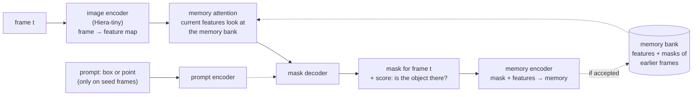
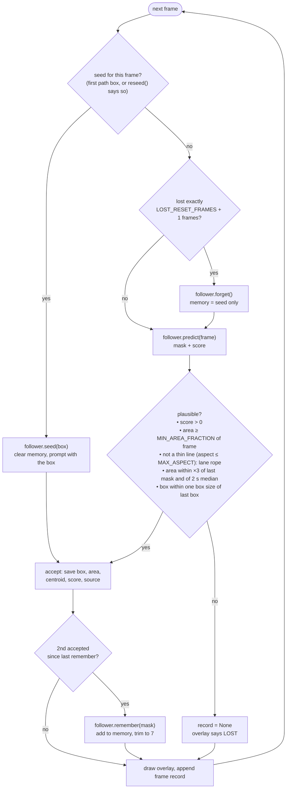
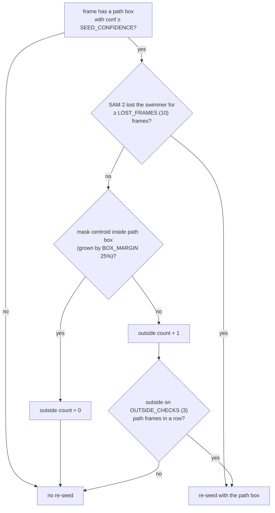

# 3. Following the swimmer: SAM 2

Code: `src/track_sam2.py` (`Sam2Follower`, `plausible`, `track`) and
`make_reseeder` in `src/analyze.py`. Weights: `sam2.1_t.pt` (tiny),
run at `imgsz` 640 through Ultralytics' `SAM2DynamicInteractivePredictor`.

## What SAM 2 is

SAM (Segment Anything) turns a prompt (a point or box) into a pixel mask of
"the thing there". SAM 2 adds **memory** so it can keep segmenting the same
thing in later video frames with no new prompt.

- **Seed frame**: the prompt tells the decoder what to segment; the result
  goes into memory.
- **Later frames**: no prompt. Memory attention finds the region of the new
  frame that looks like what memory holds, and the decoder outlines it.

In the stock SAM 2 the memory is updated automatically every frame. Here the
code **controls** it (`Sam2Follower`): only masks that pass the checks go
in, and it keeps the seed plus the latest accepted masks, `MEMORY_FRAMES`
(7) in all, adding one every `MEMORY_EVERY` (2) accepted frames. A bad mask
never enters memory, so it cannot teach SAM 2 to follow splash.

## Per-frame loop

## When to re-seed: `make_reseeder`

Called on every frame after the first seed. Returns a path box (from
[2](02-yolo-world.md)) or nothing.

Two ways SAM 2 goes wrong, two fixes:

| failure | seen as | fix |
|---|---|---|
| loses the swimmer (dive, splash, turn) | no accepted mask for a while | forget to seed-only memory after 5 frames; re-seed from YOLO after 10 |
| follows the wrong thing confidently (splash, rope, other lane) | mask keeps passing checks but sits outside YOLO's box | re-seed after 3 path frames outside |

## Output

`sam2_track.json`: per frame `{box, area, centroid, score, source}` or
`null`. `source` is `seed` or `track`. Everything in
[4](04-timing-and-strokes.md) is computed from these numbers alone; the
masks themselves are not saved.
