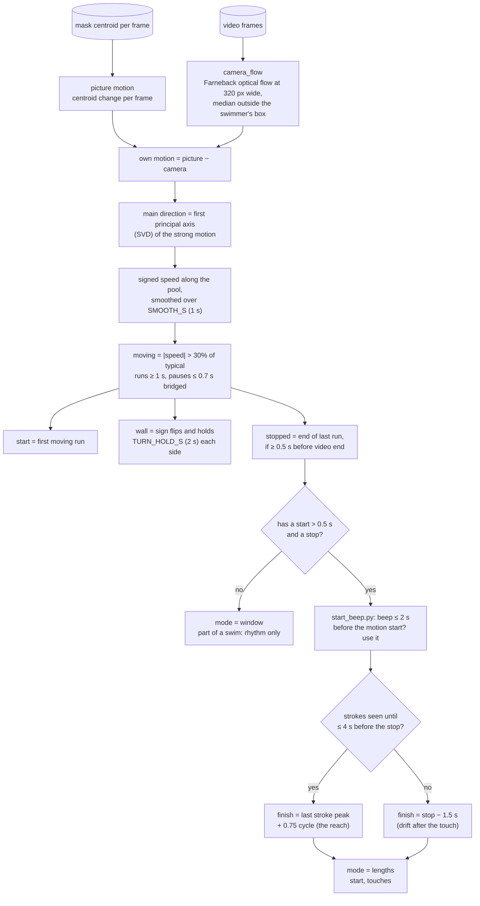
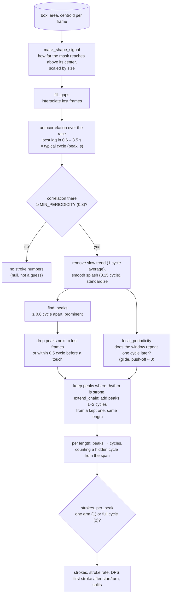
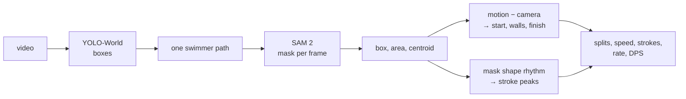

# 4. Times and strokes

No neural network from here on. Input is `sam2_track.json` (a box, area
and centroid per frame) plus the video's pixels and audio.

## Times: start, walls, finish

Code: `src/timing.py`, `find_times` in `src/analyze.py`, `src/start_beep.py`.

The camera pans with the swimmer, so the swimmer barely moves in the
picture. Their real motion = motion in the picture − camera motion.

Pixels are never turned into meters: the camera zooms and sees the pool at
an angle. Only the *times* come from the video; speed = pool length ÷ split.

## Strokes: from the mask's shape

Code: `src/race_stats.py`, `strokes_per_peak` in `src/analyze.py`.

A recovering arm lifts out of the water and stretches the mask upward. So
per frame:

> signal = (centroid y − box top) ÷ √area

rises once per arm that clears the outline.

### One arm or a full cycle per peak?

Usually only the near arm clears the outline: one peak = one arm cycle =
two strokes. Filmed close and side-on, both arms do: one peak = one stroke.
`strokes_per_peak` guesses which:

- successive peaks of similar height (`ARM_HEIGHT_STEP`), and
- the signal repeats as well two peaks on as one peak on (`ARM_REPEAT`)

→ both arms seen, 1 stroke per peak; otherwise 2. Set from six clips; the
"Adjust" panel lets the user override it.

## Whole pipeline in one line

